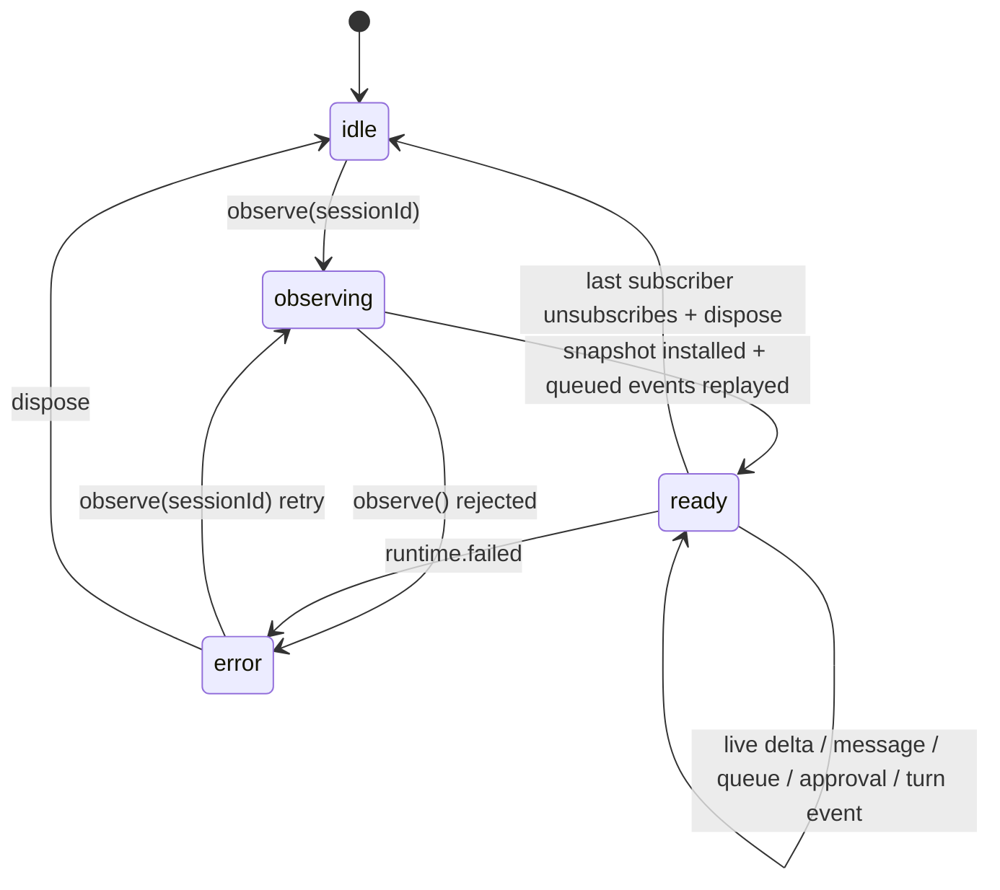
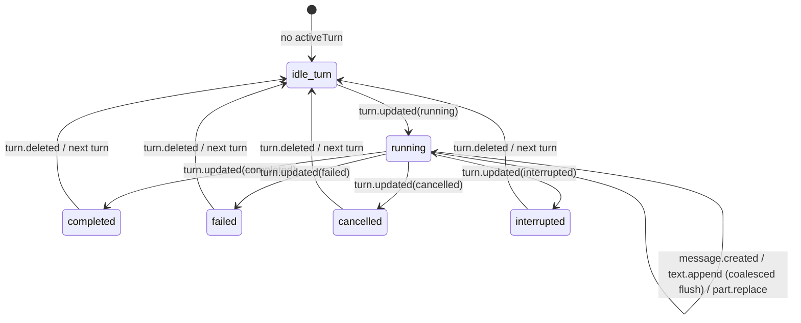
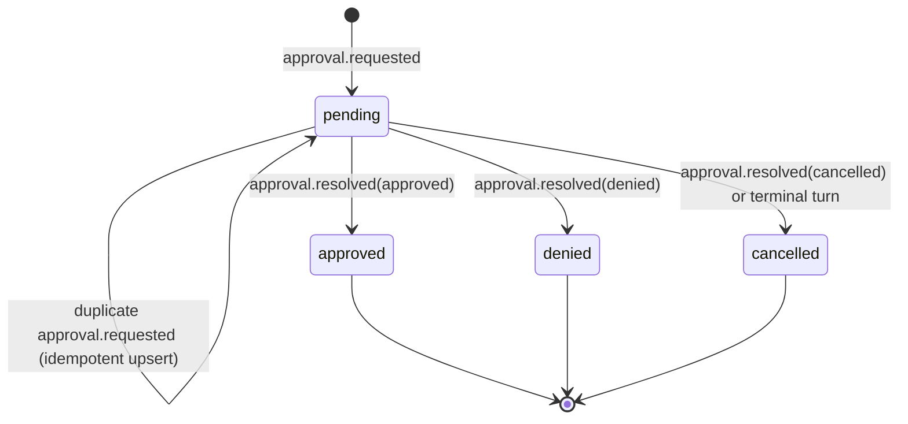
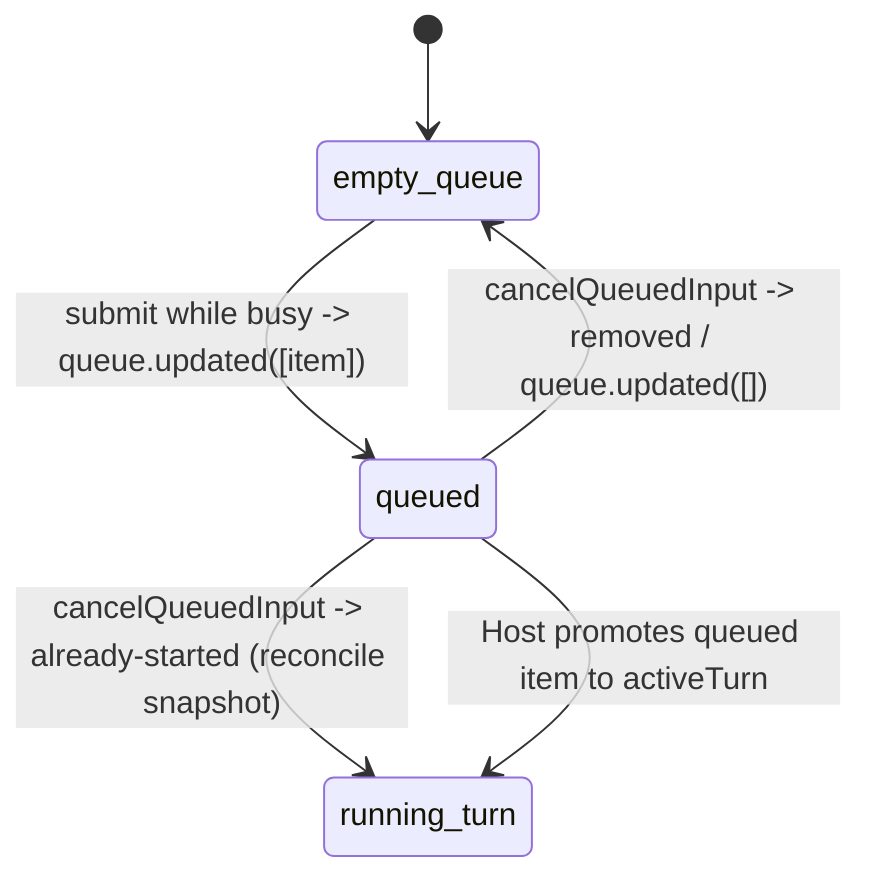

# Agent Statecharts And Invariants

This reference visualizes Cherry Mobile's highest-risk asynchronous state machines from the user's
perspective and enumerates the invariants verified automatically in CI. A single passing screenshot
cannot show which transitions are permitted or forbidden; review these statecharts alongside test
and device evidence when changing conversation streaming, tool approvals, or queued inputs.

## 1. Session Observation And Streaming Lifecycle

Owned by `AgentSessionChatClient` (`src/frontend/features/chat/runtime/AgentSessionChatClient.ts`).

### Active Turn Transitions

### Verified Invariants (Session & Streaming)

Automated randomized model check:
[AgentSessionChatClient.invariants.test.ts](../../../src/frontend/features/chat/runtime/__tests__/AgentSessionChatClient.invariants.test.ts).

| ID | Invariant | Forbidden State |
| --- | --- | --- |
| `I1` | **Lossless delta ordering:** Interleaving `text.append`, coalesced flush ticks, `part.add`, `part.replace`, and `message.finalized` preserves every streamed character in exact order. | Dropped, duplicated, or reordered assistant text chunks. |
| `I2` | **Terminal turn clears interactive gates:** Transitioning `activeTurn.status` to `completed`, `failed`, `cancelled`, or `interrupted` clears `pendingApprovals` to `[]` and `pendingQuestion` to `null`. | A settled turn still showing an actionable approval or question prompt. |
| `I3` | **Approval set uniqueness:** Repeated `approval.requested` events with the same `id` upsert rather than duplicate; `approval.resolved` removes only its own `id`. | Duplicate approval cards for one tool call, or resolving one approval clearing a sibling. |
| `I4` | **Deleted turn/message cleanup:** `turn.deleted` or `messages.deleted` removes affected rows from `liveMessages` and clears `activeTurn`, `pendingApprovals`, and `pendingQuestion` when the active turn is deleted. | Stale `activeTurn` pointing to a deleted assistant message. |
| `I5` | **Runtime failure fails safe:** `runtime.failed` transitions client `status` to `'error'` and clears `contextUsages` without throwing on subsequent cleanup or disposal. | Silent stale `ready` status after storage/runtime failure. |
| `I6` | **Zero leaked flush timers:** Finalizing a message or disposing the client cancels pending coalesced flush timers so advancing clocks triggers no phantom state updates. | Unflushed text resurrecting a finalized or disposed session. |

## 2. Tool Approval Policy And Gate

Owned by `src/shared/utils/agentToolApproval.ts` and `AgentSessionChatClient`.

### Verified Invariants (Policy Composition)

Exhaustive state-space check:
[agentToolApproval.invariants.test.ts](../../../src/shared/utils/__tests__/agentToolApproval.invariants.test.ts).

| ID | Invariant | Forbidden State |
| --- | --- | --- |
| `A1` | **Fail-closed deny monotonicity:** Explicit `deny` is never promoted to `ask` or `auto` under any Agent mode or eligibility flag. | Auto-mode overriding an explicit tool denial. |
| `A2` | **Third-party MCP floor:** `clampMcpToolApproval` never returns `auto`, even for legacy persisted `auto` rows. | Unsanctioned third-party MCP tool bypassing interactive approval. |
| `A3` | **Consent-gated eligibility:** When `autoApprovalEligible` is `false` (cost-bearing or OS permission-gated), `applyToolApprovalMode` never promotes `ask` to `auto`. | Silent auto-approval of permission- or cost-gated tools. |
| `A4` | **Idempotence:** Applying `clampMcpToolApproval` or `applyToolApprovalMode` repeatedly yields the same decision as applying once. | Repeated projection changing an approval outcome. |

## 3. Queued Follow-Up Input And Placement Reconciliation

- `isAgentSessionBusy(state)` remains `true` whenever `state.activeTurn` is non-terminal,
  `state.queuedInputs.length > 0`, or `state.isSubmitting === true`, and returns `false` once all
  three settle.
