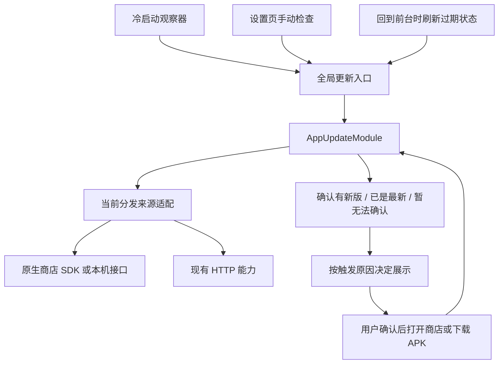

# 应用更新基建设计

状态：设计方案，尚未按本文完成改造。日期：2026-11-02。

本次统一应用内检查版本和执行更新。更新日志只在**冷启动检查确认有可更新版本后**的提示弹窗中展示，
沿用既有读取能力，不增加独立入口、历史列表、日志模块或日志服务。

## 1. 基建边界

这是应用级基建，统一由已有 `AppUpdateModule`（前端调用的应用更新工作流）承载。
业务页面只请求检查更新、观察状态，不识别厂商、不拼商店地址、不管理下载安装。

先扩展现有模块和原生包，保持项目已确定的所有权：

| 位置 | 负责什么 |
| --- | --- |
| `src/shared/contracts/appUpdate.ts` | 更新来源、检查结果、更新目标、动作和下载状态；保持纯 TypeScript |
| `src/backend/services/appUpdate` | 来源选择、版本判断、厂商结果归一、动作校验、APK 传输生命周期 |
| `modules/app-update` | Expo 原生包：安装来源、商店能力检测、厂商 SDK、定向跳转、Android 安装器 |
| `src/frontend/appShell/appUpdate` | App Shell（负责全局启动与交互的前端层）：检查时机、请求缓存、提醒节流、统一弹窗 |
| `src/frontend/features/settings/about` | 设置页自己的检查入口，消费 `useAppUpdateEntry` |
| `src/bootstrap/composition` | 创建唯一更新模块，注入依赖，随应用生命周期释放 |

当前只有 Mobile 这一应用消费者，因此公共边界是 `AppUpdateModule` 和现有原生包；本次不增加
`packages/*` 下重复的更新引擎。将来有第二个独立应用消费者时，再按实际共用范围提取工作区包。
原生包自己的类型应由该包定义，通过后端适配到应用契约，消除原生包对 `src/shared` 的反向引用。

## 2. 统一能力

更新模块保留少量明确的方法，不增加通用命令系统或第二套下载管理。

| 接口 | 契约 |
| --- | --- |
| `check(signal?)` | 查询当前安装来源对应的可更新版本；不弹窗、不下载、不安装 |
| `openStore(action)` | 打开指定商店；既支持已确认新版，也支持明确的手动前往商店动作 |
| `download(apkRelease)` | 仅公开 APK 分发可用，开始或复用应用级下载 |
| `getDownload()` / `subscribeDownload()` | 向所有入口提供同一个下载状态 |
| `cancelDownload()` | 取消并清理未完成文件 |
| `install()` / `requestInstallPermission()` | 用户确认后交给系统安装器或现有权限队列 |
| `releaseNotes(release, language)` | 沿用既有能力，仅由冷启动更新提示读取，不作为独立产品能力 |

前端通过 `useAppUpdateEntry` 和全局 Provider（持有共享更新交互状态的组件）消费能力。
页面不接触具体厂商、原生 SDK 对象、HTTP 客户端或下载路径。

`isEnabled` 需要逐步改成明确的能力描述：能否自动查询、能否前往商店、能否直接下载。
例如 OPPO 暂未配置自动查询时，仍可保留手动商店入口，不能因为不能查询就隐藏全部更新能力。

## 3. 统一结果与版本身份

对外保留三种检查结果；加载状态属于前端查询，传输状态属于下载器：

| 结果 | 含义 | 允许的后续动作 |
| --- | --- | --- |
| `available` | 当前来源确认了适用于当前安装的更新目标 | 展示版本，用户确认后更新 |
| `upToDate` | 本次成功查询明确表明没有可更新目标 | 手动检查时反馈结果；自动检查保持安静 |
| `unavailable` | 未获得足以判断的结果，附结构化原因 | 重试，或提供已检测到的手动商店入口 |

将当前 `storeOnly` 的手动商店动作与检查结论分开。无网络、查询超时、商店不支持、应用未上架、
目标商店不明确、凭据代理未配置、返回值无效，均不能转换为 `upToDate`。
取消继续走取消语义，不显示失败提示，也不改变此前仍有效的下载状态。

每次检查应绑定以下上下文，结果和缓存必须使用相同身份：

- **当前安装**：平台、包名、原生展示版本、原生构建号、内置分发通道。
- **更新来源**：GitCode APK、Google Play、App Store，或明确的一家国内商店；需要时包含地区。
- **更新目标**：该来源给出的版本名、构建号或稳定目标标识；未知字段保留空值。
- **证据时间**：检查时间、有效期。过期结果必须重新查询，不能长期保留可升级断言。

Android 商店适配器按原生 `versionCode`（安装包递增编号）比较；iOS 商店按其公开版本信息判断。
公开 APK 保持现有稳定版策略，不借本次重构改变预发布版本或同版本重打包规则。
统一层不把所有平台强制变成一种版本比较方式。

提醒标识包含包名、来源和目标版本；同一展示版本在不同商店或不同构建号下不是同一条提醒。
只有能建立稳定目标身份的结果才参与自动提醒。厂商返回更新可用但缺少稳定身份时，可保留手动
厂商更新入口，不拼造版本号或持久化一个随机提醒标识。

原生安装版本与内置分发通道是判断依据。OTA（兼容代码与资源的热更新）继续由现有 EAS Update
机制负责，不把 OTA 的版本字段当成已安装 APK/IPA 的版本，也不通过它改变安装渠道权限。

## 4. 来源适配

各适配器只负责自己的协议、版本比较和错误映射。统一模块决定选谁，App Shell 决定何时提示。

| 来源 | 检查路径 | 更新动作 | 当前状态 |
| --- | --- | --- | --- |
| 公开 APK | 现有 GitCode 稳定发行版与附件校验 | 应用内下载，校验后由用户启动系统安装器 | 已有实现，保留 |
| Google Play | 现有 Play 官方更新 API，查询本安装的可升级目标 | 定向打开 Google Play，必要时官方网页回退 | 已有查询；定向打开能力需要统一 |
| App Store | 现有 Apple lookup，校验应用身份和地区信息 | 官方 App Store 页面 | 已有实现，保留地区局限 |
| 荣耀 | 官方更新 SDK | 商店定向跳转，必要时调用 SDK 的官方交互 | 已核实文档，尚未集成 |
| 小米 | 官方检查更新 SDK，关闭其自动弹窗并读取回调 | 小米商店 | 已核实文档，尚未集成 |
| vivo | 本机商店查询接口与异步结果广播 | vivo 商店 | 已核实文档，尚未集成 |
| OPPO | 已确认服务端鉴权查询；客户端同等能力待确认 | OPPO 商店 | 先提供手动入口，自动查询仍有缺口 |

荣耀、小米、vivo 的客户端路径不以自建国内存储为前提。现有国内版本清单读取仅作为可选的
服务端适配；默认配置不能要求四家都先接入清单。OPPO 若采用已核实的接口，企业密钥必须留在
服务端，不能放入客户端代码或 `EXPO_PUBLIC_*`。

首版继续使用一个国内 APK。目标商店优先来自 Android 记录的安装/更新来源；来源未知且仅有
一个支持的商店时可回退；多个候选时手动选择。品牌本身不证明安装来源。
进入前台时重新核对商店能力；来源变化应取消旧检查并使旧来源缓存失效。跳转前再次检查能力。

厂商 SDK 的账号开通、包获取、最低商店版本和返回结构必须在实际接入时确认。特别是荣耀的
SDK 完整交互包含固定样式弹窗：仅查询是否可在不唤起厂商 UI 的情况下完整取数，以 SDK 实物为准。
统一层在显式用户操作前不调用会启动下载或展示厂商交互的方法。

## 5. 冷启动、手动检查与日志显示

弹窗状态必须携带触发原因，例如 `origin: 'coldStart' | 'manual'`。不能只保存一个 release，
再从页面位置或组件挂载时机猜测为什么打开。前台刷新不创建弹窗触发原因。

| 触发方式 | 是否查询 | 是否弹窗 | 是否读取/展示更新日志 |
| --- | --- | --- | --- |
| 冷启动首轮检查 | 启动完成后检查，不阻塞首屏 | 确认新版且满足提醒条件时 | **仅此路径展示** |
| 设置页手动检查 | 主动获取最新结果；已有传输时先展示传输状态 | 新版展示版本和更新动作；其他结果给出明确反馈 | 否 |
| 回到前台 | 结果过期或来源变化时刷新 | 不自动弹窗，更新入口状态即可 | 否 |
| 冷启动查询失败、无新版或只有手动商店入口 | 按检查结果结束 | 不弹更新提醒 | 否 |

冷启动继续复用现有规则：只处理该次启动的首轮结果；启动遮罩已经消失、应用处于前台、隐私确认
已完成，并且用户仍在普通落地聊天页时才提示。分享草稿、通知目的页和已进入的业务流程不被抢占。
一条稳定目标最多每 24 小时自动提醒一次；手动打开真实更新提示也计入该目标的提醒节流。
普通手动商店访问不算看过更新提醒。

日志只是冷启动更新弹窗的附属内容：先确认 `available`，再按当前 UI 语言沿用 `releaseNotes`
读取这一个更新目标的说明。按明确的目标关联，不能拿项目“最新日志”替代某家商店的目标日志。
缺失、失败或加载较慢都不影响版本提示及更新按钮；没有日志时省略该区域。
关闭该弹窗后，后续手动入口按 `manual` 展示，不因为曾有日志缓存就重新显示日志。

同一个弹窗显示时收到另一种触发，不叠加第二个弹窗；前台刷新不改变用户正在查看的目标。
点击执行更新前，如果该目标证据已过期或来源已变化，先重新查询并确认目标，而不是执行旧动作。

## 6. 请求、缓存和生命周期

- 继续用现有 React Query（前端请求去重与缓存层）协调入口，避免页面各自请求；相同上下文的
  重复检查共享一次结果。手动检查可刷新，前台检查仅刷新过期结果。
- 查询缓存按原生安装身份、分发来源、目标商店及必要地区隔离；初期保留国内 15 分钟、其他
  来源 6 小时的刷新策略。检查结果的有效期是额外上限，不能被前端缓存时间延长。
- 自动检查失败不打扰用户；手动检查给可重试状态。错误日志保留厂商错误码，UI 只消费统一原因。
- 本轮不为日志增加缓存系统；沿用现有按目标和语言的缓存。已发布说明可能被修订，改造时去掉
  “日志永不变化”的假设，采用有限有效期，且仍只在冷启动弹窗需要时请求。
- `AbortSignal` 控制 HTTP 查询和上层等待。原生请求使用请求标识、超时和一次性结算，忽略已取消
  请求的迟到回调；vivo 广播监听及 SDK 回调在结束、超时或应用模块释放时清理。
- APK 下载继续只存在一个应用级传输，页面退出不取消；用户取消和应用模块释放才终止并清理。
  复用现有 HTTP、下载、哈希校验和系统权限队列，不另建 HTTP 客户端或后台任务服务。
- 商店包不持有直接 APK 安装能力。打开商店或系统安装器只代表已交接，下一进程读取原生版本
  才能确认实际升级，不能立即标记安装成功。

## 7. 具体改造顺序

1. **整理契约与触发原因。** 在现有契约中分开查询结论、可用动作与目标身份；给全局弹窗增加
   `coldStart/manual` 来源。仅冷启动确认新版的路径读取日志。保留现有公开 APK、Play 和 iOS 行为边界。
2. **拆出来源适配。** 从 `createAppUpdateModule` 提取确实需要独立协议的厂商适配文件，统一结果映射；
   现有小型解析函数继续复用，不增加空壳基类或动态插件注册系统。
3. **接国内客户端能力。** 在原生包接荣耀、小米和 vivo，并统一商店定向跳转；按账号实际开通情况
   启用。OPPO 未接通前如实返回无法确认并提供手动商店动作，不把三家完成描述成四家完成。
4. **收敛旧清单路径与文档。** 不再把版本清单作为国内默认必需设施。若 OPPO 确实需要它，只保留
   有实际消费者的部分；删除被替代、未发布的代码和契约，不为本轮临时实现增加兼容层。
5. **验证与交付。** 获得相应授权后覆盖下列场景；源码实现、SDK 开通、构建、真机验收分别记录状态。

重点场景：不同渠道不串版本；同版本名高构建号；商店错峰审核；灰度不可升级；无商店/多商店；
过期和失败不报最新；重复检查只发一次；原生迟到回调；只有冷启动新版弹窗显示日志；日志缺失仍可更新；
用户已有草稿/会话不被打断；APK 校验失败不安装；关闭页面下载仍可观察；商店包始终不能直装 APK。

本次只形成设计文档，未新增依赖、运行构建、测试或设备验收。此前国内配置、跳转与清单读取改动仍在
工作区；三家官方客户端查询尚未接入，OPPO 自动查询与账号开通仍待完成。

## 8. 依据

- 仓库现有所有权：[Shared Building Blocks](./shared-building-blocks.md)、
  [Code Organization](./code-organization.md)、[Runtime Ownership](./runtime-ownership.md)。
- 当前实现：[后端更新模块](../../src/backend/services/appUpdate/README.md)、
  [全局更新交互](../../src/frontend/appShell/appUpdate/README.md)、
  [原生更新包](../../modules/app-update/README.md)。
- 官方：[荣耀更新 SDK](https://developer.honor.com/cn/doc/guides/101421)、
  [小米检查更新 SDK](https://dev.mi.com/xiaomihyperos/documentation/detail?pId=1315)、
  [vivo 自更新入口及技术附件](https://dev.vivo.com.cn/documentCenter/doc/240)、
  [OPPO 查询路径的官方跨厂商文档](https://swsdl.vivo.com.cn/appstore/developer/uploadFile/20260729/zb94ha/安卓厂商自更新通用技术文档.docx)、
  [Google Play 更新 API](https://developer.android.com/reference/com/google/android/play/core/appupdate/AppUpdateInfo)、
  [Apple lookup](https://developer.apple.com/library/archive/documentation/AudioVideo/Conceptual/iTuneSearchAPI/LookupExamples.html)。
