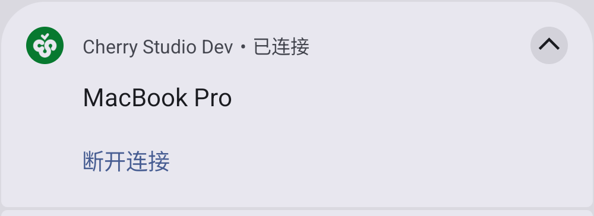
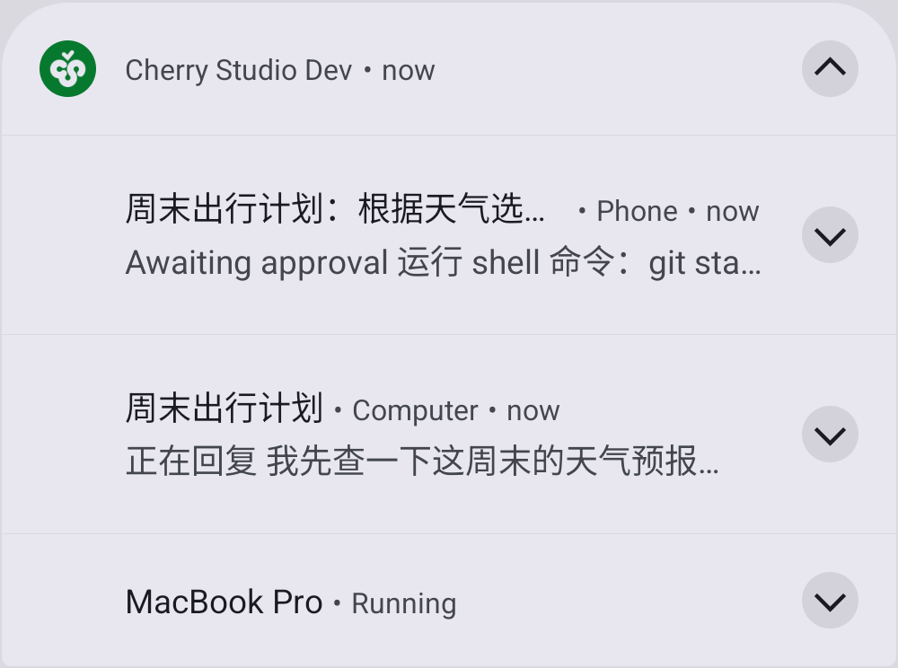
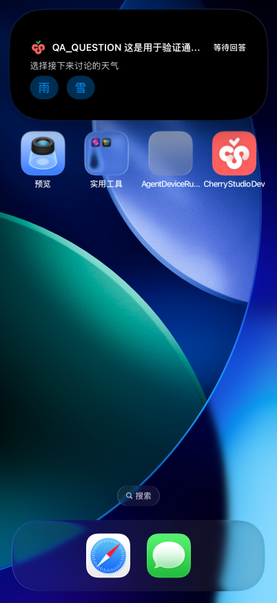

# Background Activity Presentation

The shared activity manager owns task surfaces and their retirement. Execution demand stays with
`KeepAliveCoordinator`; presentation preferences, notification permission, and app visibility never
release an unfinished conversation's execution lease. “Conversation” here means an admitted round,
including preparation, tool use, awaiting user input/approval, persistence, and final delivery.
Stored history and an idle chat page do not keep execution alive.

## One Destination, One Surface

A local conversation is identified by its session URL; a desktop conversation includes both the
connection and session IDs. Painting keeps its existing task URL. The URL contract lives in
[`taskLink.ts`](../../src/shared/backgroundActivity/taskLink.ts).

Each destination owns one logical slot. A new round takes over its predecessor; approval and
terminal content update that slot. Concurrent destinations may each show one card. Navigation to
an ongoing task does not dismiss its execution notification or cancel its work.

| Presenter requirement | iOS Live Activity | Android notification |
| --- | --- | --- |
| `presentWhile` | `always` | `always` |
| `requiresForegroundStart` | `true` | `false` for the surface; service admission still requires foreground |
| `requiresPredecessorRetirement` | `true`: await deletion of the ended native identity before a new card | Not required: numeric identity is reused |
| `shouldHoldLeaseUntilDelivery` | `true` | `true` |

A Live Activity is created when foreground preparation starts and retained across app visibility
changes. If work is first observed while hidden, its card waits for foreground admission. The
manager checks native identity before updates and retirement: a card removed by the person or the
system stays dismissed for that round. Removal does not cancel execution. ActivityKit remains a
presentation mechanism, not an execution guarantee.

The iOS **Live Activities** preference controls chat and painting cards only. Turning it off
retires presentation without releasing execution. The persisted `chat.background_reply.enabled`
key is retained for compatibility. Android's mandatory service notification remains independent of
that preference. Completion preferences control completion alerts; they do not turn protection off.

## Execution And Attention

Preparation hands its lease to the round before releasing it. Awaiting a question or approval keeps
that lease. Terminal content appears immediately, while bounded final metadata work and notification
delivery retain protection. The lease releases after delivery settles, including delivery failure.

Android uses persistent numeric notification IDs shared between its existing foreground service
and the SystemIntegration notification bridge. One conversation anchors the service notification;
other conversations have their own cards. The anchor moves without restarting execution. See
[Android Background Generation](./android-background-generation.md).

The native service owns foreground admission and anchor identity; SystemIntegration owns notification
content. Same-anchor text and visibility updates must not repost the service's plain fallback over a
Live Update. Moving the anchor reuses the destination's existing card; settling an anchor updates its
ongoing state before detachment. This prevents streaming text from repeatedly demoting and promoting
the same island.

iOS completion delivery checks permission and current generation, retires its settled Live Activity,
then posts a deterministic completion notice for that destination. This replacement retains a short
delivery lease. A superseded round cannot retire or post over its successor.

Local and observed desktop sessions distinguish waiting for approval from waiting for an answer.
The compact Live Activity replaces its timer with the translated waiting label and attention icon.
Each request carries its approval, tool-call, or remote interaction identity: title/preview updates
stay silent, while consecutive requests each receive an alert even without an intermediate running
phase. Both waiting states retain execution demand.

On iOS, pending decisions also raise a local notification independently of the Live Activities and
completion-notification preferences. Notification permission is requested once after a user starts a
round, including when completion alerts are disabled. Foreground decisions use the existing in-app
attention channel; the currently visible session suppresses that message. Background alerts contain
the session title and a translated waiting label; actionable single questions also include their prompt.
The ongoing Live Activity remains available. Resolving or retiring a request clears its alert;
generation checks suppress obsolete queued delivery. Tapping the alert opens the exact local or
desktop session, where the existing approval and question controls handle the decision. Opening a
decision notice never approves a tool or releases execution protection.

Android updates its existing ongoing task notification and alerts once per pending request. On
Android 16 and newer, an unfinished user-started task requests standard Live Update promotion with
its current status as the status-chip text. Completed messages and standalone alerts remain ordinary
notifications. The system owns promotion and user dismissal; a foreground-service notification alone
does not establish that the task was promoted. Compatible OEMs may render the standard Live Update
on their island surface. This does not implement Xiaomi's separate proprietary focus-notification
protocol or imply that all Android devices expose the same surface. See Android's
[Live Update guidance](https://developer.android.com/develop/ui/views/notifications/live-update).

### Direct Decisions

Pending approvals expose Allow and Deny. A single question with single selection exposes up to two
option buttons; Android's system reply field also offers all option labels and accepts free text.
On Android 16 and later, a separate ordinary notification hosts text reply while the promoted status
card retains its buttons. Promoted Live Updates must hide RemoteInput actions under
[Android 16 CDD 3.8.3.1/H-0-5](https://source.android.com/docs/compatibility/16/android-16-cdd#2_2_3_software).
The reply notice is silent and retires when the request resolves, changes, or its task is dismissed.
iOS notifications offer a text reply action. iOS Live Activities expose the option or approval
buttons on their expanded and Lock Screen layouts; text entry remains a notification interaction.
Live Activity buttons share equal width and stay neutral; only Allow uses the `primary` green.
Multi-question, multiple-selection, and text-change review forms retain the in-app interaction.

The live reply owns an opaque token for the exact request and generation. Native controls carry
only that token and an action identifier, and never replay model work. The backend resolves through
the existing local Host or desktop interaction command, checks that the request is still current,
and ignores duplicate, replaced, retired, or already-resolved requests. Action delivery does not
require a visible chat screen. Android uses a non-exported notification-action receiver and a
bounded native inbox; iOS uses notification response callbacks and Expo's Live Activity intent
events. These local actions require the owning runtime to remain available; they do not add remote
push delivery or durable execution after process death. OEM island rendering of notification
buttons still requires device acceptance; notification actions alone do not prove parity.

Simple question text appears on actionable cards so a person can answer it. Tool arguments remain
available in the app's approval detail view. Android retains private Lock Screen visibility, and
iOS labels retain privacy-sensitive presentation. System notification preview settings also apply.

The interaction follows the separation between progress and decisions in
[Claude Code Remote Control](https://code.claude.com/docs/en/remote-control#mobile-push-notifications):
keep progress glanceable and draw attention when approval or an answer is required.
[OpenAI's notification controls](https://learn.chatgpt.com/docs/notifications) similarly distinguish
turn-completion alerts from permission and question notifications.
These are locally delivered alerts while the Mobile process can receive events. APNs/FCM device
registration and a desktop/server push sender are not implemented; after iOS suspends Mobile,
remote events cannot refresh its card or trigger an alert until execution resumes. A Live Activity
does not extend the finite UIKit execution window. Reliable suspended-app delivery requires that
separate end-to-end push transport.

## Settled Surfaces

Cancellation retires a card immediately. When the phone stops protecting a desktop conversation,
such as after a minute of hidden unreachability, its card retires silently: the desktop still owns
execution, so no terminal state or notice appears, and foreground recovery restores tracking. A
completed or failed card remains available until the person opens its destination or a new round
replaces it. A destination already visible when the
round settles retires its result immediately. Merely opening the app does not acknowledge other
conversations. Drawer-covered screens do not acknowledge results.

Settled Live Activities have a 30-minute dismissal date. The shared manager retains their handles
for the same window. Android terminal notices remain dismissable by persistent destination identity
across process restarts. Cold startup clears orphaned ongoing surfaces without replaying paid work.
An ended Live Activity cannot be enumerated after restart; its dismissal date retires it.

## Brand Artwork

Brand artwork is limited to the existing `assets/icon-light.png` and `assets/icon-dark.png`.
iOS stages exact copies of both: Lock Screen banners follow the system surface's appearance,
while every Dynamic Island size uses the dark artwork on its black background. Images retain
full-color rendering; action/status colors must not recolor the logo. Android supplies the
launcher artwork as its large icon and uses Cherry `brand` red for the system small-icon badge.
Standard Android status chips still render their small icon as a system-controlled monochrome mask;
supplying a large icon does not provide Xiaomi's proprietary full-color island integration.

## Privacy And Payloads

Reply previews, titles, assistant attribution, and painting prompts use SwiftUI `privacySensitive`.
Android notifications use private lock-screen visibility. Actual redaction follows system settings.

The Live Activity presenter bounds every start, update, and end to 3 KB of measured UTF-8 content,
reserving 1 KB of ActivityKit's 4 KB allowance for native encoding. Text is shortened at Unicode
code-point boundaries. Identifiers and state are not truncated; invalid final metadata still ends
the card. This does not change stored task content.

## Capability And Settings

The frontend consumes the coordinator's public execution status rather than inferring protection
from a visible card. Android reports active only after native foreground-service proof. Denied
admission is limited; revocation is interrupted. iOS uses a finite UIKit background task and reports limited even after admission.
The last lease release ends the assertion. Expiration ends it natively, then notifies held
consumers to interrupt their work; no new assertion is requested in the same background stay.
Returning to foreground permits a new window for remaining or newly started work. Late expiration
callbacks cannot interrupt a replacement window. Suspension may delay JavaScript cleanup; cold
startup still reconciles unfinished work. This does not promise a fixed duration or automatic replay.
System low-power, battery-optimization, Live Activity, and notification settings are separate facts.
Manufacturer-specific autostart/background restrictions require manual confirmation.

iOS 26 continued-processing tasks are not integrated in this change. Their progress, expiration,
and system-owned presentation require native feasibility acceptance before extending the finite
UIKit window. Neither current platform mechanism promises survival of force-stop or process death.

## Acceptance

When device verification is authorized, cover foreground admission and continued background/locked
execution; immediate lock after send; questions and approvals; concurrent conversations; one slot
across repeated rounds; completion while hidden versus already visible; notification permission
denial; disabled presentation; user-dismissed cards; process restart; power restrictions; and long
multilingual payloads. Native acceptance must also confirm retirement of an ended Live Activity before its replacement,
including completion-notice handoff. Native delivery and OS behavior require a rebuilt client; lint
and source guards are insufficient.

The following examples show an Android connection notice and a notice list (expanded from
Android's own app bundle) from an Android 16 emulator, and an iOS single-question Live Activity on
the simulator Lock Screen, all from a local presentation fixture. The fixtures validate native layout
and action delivery, not a live desktop transport or suspended-app remote push.

